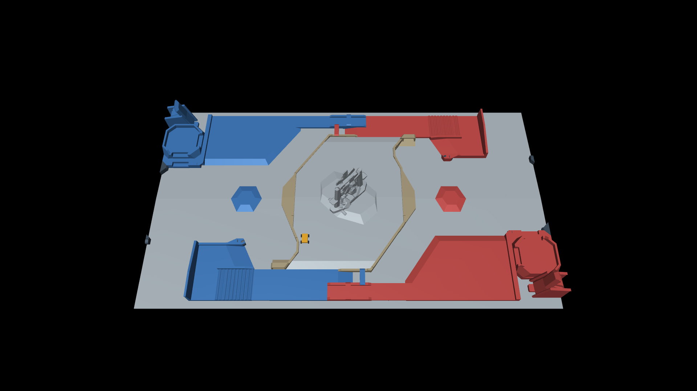
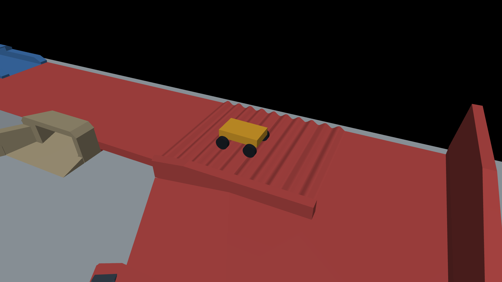

# RMUC 2027 MuJoCo 场景测试报告

**结果：通过。** 本报告对应已审核的 v3 外形，未在导出时再次简化。完整测试时间：2026-11-09T01:12:17.331366+08:00。六条行驶路线、20 个竖直接触点、高台阶阻挡及两项速度测试均通过。

## 交付与模型规模

- 单位为米、千克、秒；场地静态，机关为粗外形，没有运动机构。
- 保留 42 个 CAD 实例；已移除两侧基地、前哨站、资源站／兑换站及相关专用底座、工作台和能量单元。风机、堡垒及中央机关保留粗外形。
- 碰撞体共 **1,365 个**，其中 13 个盒体和 1,352 个凸网格，碰撞三角面 34,152 个。相对原 CAD 参考离散网格的 4,396,969 个三角面减少约 99.22%。这不是实测提速比例。
- 42 个纯色显示网格不参与碰撞，无图片贴图。`scene_physics.xml` 在编译时丢弃显示网格。
- 保留真实地面双坡、回收开槽、台阶和坡面；没有使用额外大平面封住凹槽或通道。

三个入口均在 MuJoCo 中实际编译成功。下列几何数包含显示／测试车，场地碰撞体数量始终为 1,365。

| 入口 | 几何数量 | 网格数量 | 刚体数量（含世界） | 本次编译耗时 ms |
| --- | ---: | ---: | ---: | ---: |
| `scene.xml` | 1,407 | 1,394 | 1 | 64.9 |
| `scene_physics.xml` | 1,365 | 1,352 | 1 | 62.5 |
| `rover_test.xml` | 1,412 | 1,394 | 6 | 61.2 |

`scene_physics.xml` 用于纯物理训练；`scene.xml` 用于带纯色外表面的查看；`rover_test.xml` 带测试车。接入和启动方式见 [README](README.md)。请保留整个文件夹的相对结构。

## 测试条件

本机：Intel(R) Core(TM) i7-14700，Windows-11-10.0.26300-SP0，Python 3.12.15，MuJoCo 4.0.0。步长 2 ms，`implicitfast`、Newton 求解器。

使用 **20 kg 通用四轮车**：轮半径 0.10 m、轮宽 0.07 m、轴距 0.46 m、轮距 0.50 m、车体 0.64 × 0.40 × 0.13 m，无悬挂，每轮驱动扭矩上限 6 N·m。用户未提供实际机器人。平地和中央通道目标速度 0.60 m/s，坡道和公路目标速度 0.45 m/s。

场地摩擦参数为 `0.9 0.005 0.0001`，车轮摩擦为 `1.15 0.005 0.0001`；均为可调假定，未测定实物材料。

## 行驶与接触

| 路线 | 目标距离 m | 实际进度 m | 最大横向偏差 cm | 最大接触穿透 mm | 结果 |
| --- | ---: | ---: | ---: | ---: | --- |
| 平地 | 4.50 | 4.527 | 0.56 | 1.846 | 通过 |
| 中央通道 | 6.60 | 6.611 | 2.11 | 2.056 | 通过 |
| 红侧梯形高地坡道 | 2.80 | 2.820 | 7.33 | 1.590 | 通过 |
| 蓝侧梯形高地坡道 | 2.80 | 2.821 | 7.34 | 1.590 | 通过 |
| 红侧公路圆滑起伏 | 3.70 | 3.717 | 0.89 | 1.846 | 通过 |
| 蓝侧公路圆滑起伏 | 3.70 | 3.716 | 0.93 | 1.846 | 通过 |

全部路线无 MuJoCo 数值警告、无车体刮底，六条路线中的最大接触穿透为 2.056 mm。路线通过判据包括到达目标附近、横向偏差小于 0.30 m、未翻倒、接触穿透小于 10 mm、状态有限且无数值警告；表中给出实测值。轨迹见 `test_trajectories.json`。

20 个竖直约束球形探针（半径 35 mm）覆盖地面、设施删除区域、中央高地、两侧梯形高地、公路平段、两侧三级台阶和 4 个精确接缝位置。全部能被表面稳定承托，最大平衡高度偏差 **0.02884 mm**，通过阈值为 2.5 mm，无数值警告。探针并非自由滚动球。

高台阶阻挡测试通过：记录 1389 个壁面接触帧，测试车最小 Y 坐标为 -2.32803 m，台阶前沿为 -2.6522 m，最大接触穿透 1.590 mm。本项证明台阶作为障碍物起作用；不表示本车能爬上高台阶。

## 编译后几何核验与接缝说明

核对基准为已审核的 `collision_draft.json` v3，而非重新导入 STEP。逐一重建并比较全部 1,365 个碰撞体的编译后世界顶点与包围盒：最大顶点差 **0.000554923 mm**（约 0.555 μm），最大包围盒差 0.000537736 mm。移除设施实例的检查通过。

共检查 5,105 条竖直射线：全场随机 1,800 点、两侧公路截面 2,402 点、台阶中心截面 301 点、中心两侧各偏移 0.1 mm 的内部截面共 602 点。无缺失／额外命中；非边界最大高度差为 0.000077788 mm。

其中 **26 个恰好位于 X=12 m 台阶竖直接缝的零宽射线样本**不能用普通内部高度误差解释：MuJoCo 的浮点网格存储产生微米以下的坐标偏移，单条射线可能选中邻阶或从极窄拼缝命中下方地面。原始最大高度差 **399.1368 mm** 如实保留在 `export_validation.json` 中，没有将其当作允许的地形变形。

这 26 点均在源竖直边界 5 μm 范围内；邻域偏移 10 μm 的内部射线均吻合，两侧偏移 0.1 mm 的截面通过。另对 4 个代表性接缝进行有限半径接触测试，均被上层表面承托。若使用零宽射线建立高度图，应避开恰好落在竖直接缝上的单点，或使用微小邻域多点结果。

此处的极小误差仅反映 v3 到 MuJoCo 的导出保真度。此前 v3 对 CAD 缓存的表面采样最大距离约 3.4 mm、公路截面最大高度差约 0.58 mm，属于另一项简化误差指标；均不是实物精度保证。

## 无渲染运行速度

单 CPU、单辆测试车，包含完整 1,365 个场地碰撞体，步长 2 ms，丢弃纯显示几何。每种负载运行 60 段各 1 秒的接触仿真；每段恢复相同的稳定接触初始状态。只计 `mj_step`，不计状态恢复、`forward`、编译、日志或渲染。

| 接触负载 | 累计模拟秒 | 物理步进墙钟秒 | 实时倍数 | 平均每步 μs |
| --- | ---: | ---: | ---: | ---: |
| 中央地形接触 | 60.0 | 0.858851 | 69.86× | 28.628 |
| 公路凸起接触 | 60.0 | 1.317223 | 45.55× | 43.907 |

两项计时均无数值警告且有真实接触。约 46～70 倍实时只适用于上述本机条件；不是相对原始 STEP 的提速倍数，也不代表 GPU 并行训练吞吐。

## 查看、复测与适用范围

Windows 可双击 `launch_scene.cmd` 查看场地，双击 `launch_rover.cmd` 查看车辆经过公路凸起。本机窗口查看和无窗口演示均已实际运行。空格暂停，R 重置，关闭窗口退出。换电脑需按 README 安装依赖；便携包不包含 Python 环境。

双击 `run_tests.cmd` 复测，或在已安装依赖的环境中运行：

```powershell
python validate_scene.py --render
python view_scene.py --route central_passage --physics
```

`test_results.json`、`test_trajectories.json` 和本报告保存本次结果；复测会更新前两个文件，指定 `--render` 还会更新截图。本报告及交付时的 `SHA256SUMS.json` 不会自动刷新。

本次验证不覆盖所有位置的通行净空、所有速度和控制器、实际参赛机器人的动力学或机关运动。更换机器人后需要按实际轮胎、尺寸、质量、悬挂和控制器重新验证。

## 实际 MuJoCo 截图





数据依据：`test_results.json`、`export_validation.json`、`metadata.json`。官方图纸和资料来源见 [README](README.md#来源)。
